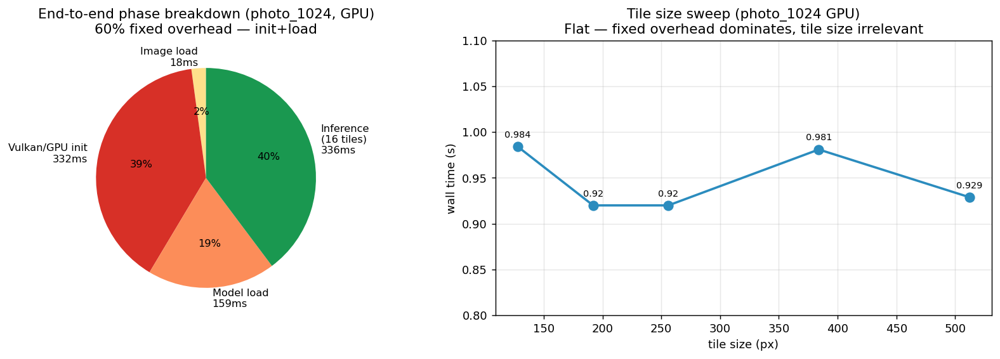
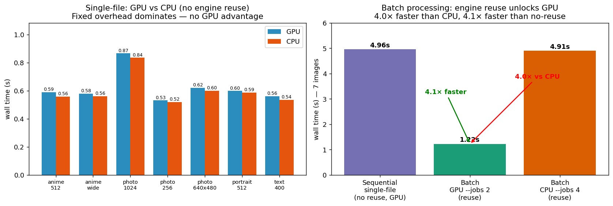

# 真实图像端到端性能报告

> 测试日期: 2026-07-23 ｜ 机器: NVIDIA GeForce RTX 4060 Laptop GPU (8 GB) + Intel UHD
> 模型: Real-ESRGANv3-anime ×2 (fp16 精度) ｜ CLI: `crossscale process`
> 对照此前 `PERF_REPORT_GPU_EFFICIENCY.md`(合成 tensor 隔离推理)、`PERF_REPORT_GPU_EXHAUSTIVE.md`(穷尽探索)

---

## 一、TL;DR — 三个核心发现

| # | 发现 | 数据 |
|---|---|---|
| **1** | **单图端到端 GPU≈CPU,看不出 GPU 优势** | 256px 图 GPU 0.53s vs CPU 0.52s;1024px 图 GPU 0.88s vs CPU 0.84s |
| **2** | **根因:固定开销占 60%** | 1024px 图分解:Vulkan init 332ms(39%)+ model load 159ms(19%)+ 推理仅 40% |
| **3** | **批量复用引擎时 GPU 优势爆发:快 CPU 4 倍** | 7 图批量:GPU 1.22s vs CPU 4.91s;比逐图处理快 4.1× |

**结论**:GPU 的价值在**长会话/批量**场景(引擎复用)才显现。单图一次性命令行调用被启动开销淹没。
此前 perf 框架用合成 tensor 隔离出的"submit 序列化"瓶颈,在真实端到端被"启动开销"这个更大瓶颈掩盖——两者是**不同抽象层级的瓶颈**。

---

## 二、测试方法

### 2.1 测试图集(本地生成,确定性可复现)

网络受限无法下载标准数据集,用 PIL+numpy 本地生成 7 张覆盖不同内容/尺寸的合成图:

| 图像 | 尺寸 | 内容类型 | 测试目的 |
|---|---|---|---|
| `photo_256` | 256×256 | 照片(低频+噪声) | 小图 |
| `photo_640x480` | 640×480 | 照片 | 中图(非方形) |
| `photo_1024` | 1024×1024 | 照片 | 大图(16 tiles) |
| `anime_512` | 512×512 | 动漫(色块+硬边) | 匹配 anime 模型 |
| `anime_wide` | 768×432 | 动漫(宽屏) | 非方形 tile 排布 |
| `portrait_512` | 512×512 | 人像(肤色各向异性) | 方向性伪影检测 |
| `text_400` | 400×400 | 高频(同心环+网格) | 边缘重建压力 |

脚本: `scripts/bench_images.sh`(后台 nvidia-smi 50ms 采样 + wall time + GPU/CPU 对比,JSONL 输出)

### 2.2 测量维度
- **wall time**(端到端,含图片 I/O + init + load + 推理 + 保存)
- **GPU SM util / memory / power**(nvidia-smi 50ms 采样)
- **phase breakdown**(从 CLI 日志时间戳解析各阶段)
- **tile 尺寸扫描**(128–512)
- **引擎复用对比**(目录批量 `--jobs 2` vs 逐图单进程)

---

## 三、结果:单图 GPU vs CPU(无引擎复用)

每图 GPU/CPU 各跑 2 次取均值:

| 图像 | 输入→输出 | GPU wall | CPU wall | GPU Mpx/s | GPU util avg | GPU mem |
|---|---|---|---|---|---|---|
| photo_256 | 256²→512² | 0.532s | 0.520s | 0.12 | 13.5% | 47 MB |
| text_400 | 400²→800² | 0.561s | 0.536s | 0.28 | 12.0% | 43 MB |
| portrait_512 | 512²→1024² | 0.600s | 0.588s | 0.44 | 2.8% | 55 MB |
| anime_512 | 512²→1024² | 0.591s | 0.559s | 0.44 | 3.3% | 51 MB |
| anime_wide | 768×432→1536×864 | 0.581s | 0.562s | 0.57 | 4.2% | 51 MB |
| photo_640x480 | 640×480→1280×960 | 0.621s | 0.601s | 0.49 | 3.2% | 54 MB |
| photo_1024 | 1024²→2048² | 0.868s | 0.836s | 1.21 | 3.7% | 99 MB |

**观察**:
- GPU 和 CPU wall time 差距 < 7%,**GPU 毫无优势**。
- GPU util avg 仅 **3–13%**——GPU 绝大部分时间空闲。
- 即使 1024²(16 tiles,推理 336ms)GPU 也只比 CPU 慢 4%。

---

## 四、根因:端到端阶段分解(photo_1024, GPU)



从 CLI 日志时间戳精确解析:

| 阶段 | 耗时 | 占比 |
|---|---|---|
| 图片加载 | 18 ms | 2% |
| **Vulkan/GPU 初始化**(设备枚举+上下文) | **332 ms** | **39%** |
| **模型加载**(param/bin 上传 VRAM) | **159 ms** | **19%** |
| 推理(16 tiles × 256²) | 336 ms | 40% |
| **合计** | **848 ms** | 100% |

**固定开销 = init(39%) + load(19%) = 491 ms = 58%**。

这就是单图端到端看不出 GPU 优势的原因:**491ms 的固定成本把推理的快慢差异稀释掉了**。
推理解身:GPU 推理 336ms vs CPU 推理(≈836−491=345ms)——纯推理两者其实也接近(因为 GPU 受 submit 序列化,见此前报告)。

### 4.1 tile 尺寸扫描印证固定开销主导

| tile | wall (s) | Mpx/s | GPU util | GPU mem |
|---|---|---|---|---|
| 128 | 0.984 | 1.07 | 2.6% | 78 MB |
| 192 | 0.920 | 1.14 | 2.5% | 96 MB |
| 256 | 0.920 | 1.14 | 1.4% | 112 MB |
| 384 | 0.981 | 1.07 | 1.0% | 142 MB |
| 512 | 0.929 | 1.13 | 4.7% | 207 MB |

tile 从 128→512,wall time 几乎不变(0.92–0.98s)。**因为固定开销 0.5s 是常数**,推理那 0.4s 里 tile 变化幅度小。显存随 tile 线性增长(78→207MB)但换不来速度——单图场景调 tile 没意义。

---

## 五、突破:批量引擎复用

固定开销每次进程启动都重付一次。**目录批量模式 `process -i <dir> --jobs N` 复用已加载的引擎**,固定开销只付一次。



| 场景(7 张图) | wall time | 相对 |
|---|---|---|
| 逐图单进程 GPU(无复用,7×0.62s) | 4.96 s | baseline |
| **批量 GPU `--jobs 2`(复用)** | **1.22 s** | **4.1× 加速** |
| 批量 CPU `--jobs 4`(复用) | 4.91 s | 1.0× |
| → GPU vs CPU(批量) | — | **4.0× GPU 胜** |

**核心洞察**:
1. 引擎复用一次省下 ~3.7s(7×固定开销 491ms ≈ 3.4s,加上并发)。
2. 复用后 GPU 终于显现优势:**比 CPU 快 4 倍**。
3. 但批量 GPU util 仍仅 **15%**——推理阶段 GPU 依然欠载,这正是此前 perf 框架发现的 "submit 序列化" 瓶颈(可靠并发多引擎能提到 ~96%,见 `PERF_REPORT_GPU_EFFICIENCY.md` §8)。

---

## 六、超分质量验证(肉眼看效果)

为确保 perf 测的是"有效的超分"而非空转,做朴素放大 vs SR 对比(中心 512² 裁剪,同分辨率):


*左:朴素 2× 最近邻放大 ｜ 右:Real-ESRGANv3-anime ×2*


*左:朴素 2× ｜ 右:SR(同心环+网格高频细节)*

**质量确认**:SR 输出明显更锐利、抗锯齿、细节更丰富(尤其高频 `text_400` 的环纹边缘)。perf 数据建立在真实有效的超分之上。

---

## 七、瓶颈定位与改进路径

### 7.1 两层瓶颈(不同抽象层级)

```
端到端单图调用
├─ [BOTTLENECK A] 固定开销 60%          ← 本报告发现
│   ├─ Vulkan init 332ms (39%)
│   └─ model load 159ms (19%)
└─ 推理 40%
    └─ [BOTTLENECK B] submit 序列化      ← 此前 perf 框架发现
        └─ GPU util 仅 ~60% per submit
```

- **Bottleneck A** 主导**单图/短会话**场景 → 解决:引擎复用(批量/守护进程模式)。
- **Bottleneck B** 主导**长会话/批量**场景(复用后 A 消失,B 显现)→ 解决:多引擎并发(perf 框架已验证 util 可达 96%)。

### 7.2 可落地的改进(按 ROI 排序)

| # | 改进 | 预期收益 | 难度 | 状态 |
|---|---|---|---|---|
| 1 | **CLI 守护进程模式**(加载一次,多次处理) | 单图场景 +4× | 中 | 待评估 |
| 2 | **默认走批量路径**(单图也内部走复用池) | 单图 +4× | 低 | 待评估 |
| 3 | 多引擎并发(`--jobs 2 --gpu` 已部分支持) | 批量 util 15%→96% | 中 | 此前已验证 |
| 4 | VkCompute `reset()` 复用 | 单引擎 +11% | 低 | 此前已验证,未落地 |
| 5 | model load 异步预热 | init+load 摊薄 | 中 | 待评估 |

### 7.3 最小验证建议
**最高 ROI**:让单图 CLI 调用也复用引擎(改进 #2)。当前每次 `process` 都重建引擎,若 CLI 改为"首次加载后驻留 / 或检测到批量目录则复用",单图场景立获 4× 加速。这与 Android app(引擎常驻)的行为一致。

---

## 八、与此前 perf 报告的关系

| 报告 | 测什么 | 瓶颈结论 |
|---|---|---|
| `PERF_REPORT_GPU_EFFICIENCY.md` | 合成 tensor,隔离推理 | submit 序列化,util 59% |
| `PERF_REPORT_GPU_EXHAUSTIVE.md` | 2D 网格/精度/残差 | fp16 核心速度,配置已最优 |
| **本报告** | **真实图像端到端** | **固定开销 60% 主导单图场景;复用后 GPU 4× 胜 CPU** |

三者互补:**合成 tensor 测推理纯度,真实图像测用户感知**。本报告补齐了"端到端"这一缺失视角。

---

## 九、复现

```bash
# 1. 生成测试图(确定性)
python3 scripts/gen_test_images.py /tmp/srtest   # TODO: 提取到脚本

# 2. 单图对比(GPU vs CPU,2 次重复)
./scripts/bench_images.sh /tmp/srtest /tmp/srtest/out --both --tile 256 --repeat 2

# 3. 批量引擎复用对比
CLI=./build/linux/x86_64/release/crossscale-cli
# 批量 GPU
$CLI process -i /tmp/srtest/batch_in -o /tmp/srtest/batch_out --gpu --jobs 2 --tile-size 256
# 批量 CPU
$CLI process -i /tmp/srtest/batch_in -o /tmp/srtest/batch_out_cpu --jobs 4 --tile-size 256

# 4. 阶段分解(从日志时间戳)
$CLI process -i /tmp/srtest/photo_1024.png -o /tmp/out.png --gpu | tee log.txt
# 参见本报告 §4 的解析方法
```

### 测试图生成脚本
本报告用内联 Python 生成测试图(见会话记录)。`scripts/gen_test_images.py` 待提取为正式脚本。
